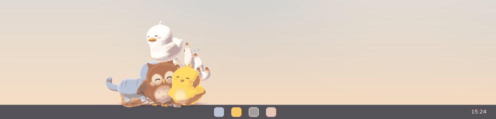
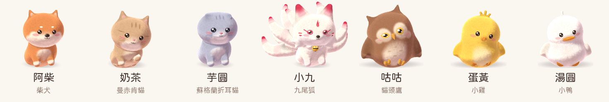
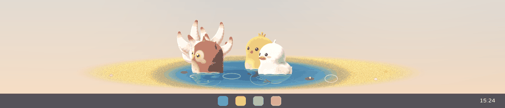
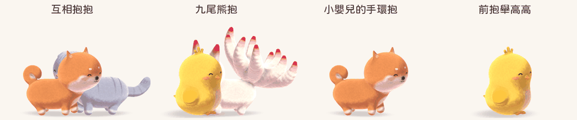
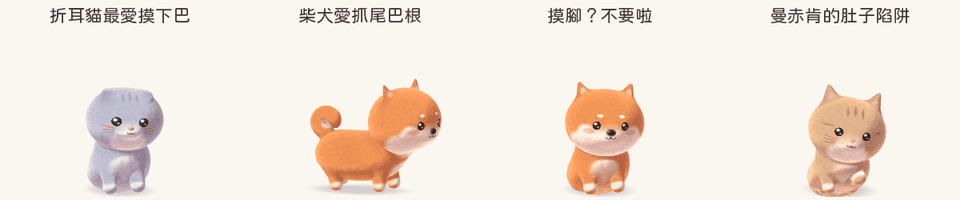

# chonkGene (肉肉賴桌)

A gang of chubby desktop pets that lounge on your desktop all day being cute.

- **Seven pets**: a Shiba Inu, a Munchkin cat, a Scottish Fold, a nine-tailed fox, an owl, a chick and a duckling, each with its own personality (the fox is a bossy big sister to the others, and tsundere to you).
- **Touch them**: bellies squish and jiggle; every pet has spots it loves (a cat's chin and belly, the Shiba's tail base) and spots it would rather you left alone; keep poking and some roll over laughing while others look thoroughly fed up. The Munchkin's belly is a trap.
- **Hugs**: double-click a pet (or 抱抱 in its menu) and a child's see-through hands hold it by its sides, pressing into its fur; the pets hug each other too, and the fox bear-hugs whoever it likes.
- **They get about**: walking, running, sliding along on their bellies, gliding down from window tops, flying off under balloons or a bamboo-copter; they hop onto windows and ride along when you move them.
- **Their own little scenes**: the duckling's pond with a golden beach (everyone wades in for a water fight), a sunbeam for the cats, a bone, seeds, a butterfly, the fox's spells, the 肉肉舞 in a spotlight.
- **Irrational mode** (on by default): with two or more pets they squabble over small things and always make up with a hug; the chick and duckling talk past each other (雞同鴨講).
- **They sleep**: snot bubbles, sleep talk, bellies rising and falling; wake them gently and all is well, shake them awake and they get grumpy.
- **Sound mode** (on by default): real animal recordings, a little tune for the dance; muted automatically in full screen.
- **Your pets, your way**: names, coat, body shape (slightly chubby by default), size (one click for all of them), personality.
- **Doesn't get in the way**: clicks pass through transparent areas; pets hide in full screen; one key hides them all.
- **Portable**: unpack and run on Windows and Linux; no administrator rights, no network access.

<table>
<tr><td></td></tr>
<tr><td></td></tr>
<tr><td></td></tr>
</table>

The UI is in Traditional Chinese first, with English to follow.

## Status

Working toward beta `0.6.0-beta.1` (the `0.5.0` betas are withdrawn): seven pets as skinned 3D meshes that walk, run, slide, glide and fly across the desktop and its windows, sit, sleep, eat, play with a grass stalk, a ball, a frisbee and catnip, do as they are asked (sit, lie down, come, spin, shake hands, dance, go and hug someone), keep you company while you read or type and look at your cursor, have little scenes of their own, play and hug together, answer touch spot by spot and never stop fidgeting, with real animal recordings. See [docs/PLAN.md §8](docs/PLAN.md#8-phases) for what is in it and what is left.

## Trying it

Download the archive for your system from [Releases](https://github.com/ragnarokmin0714/chonkGene/releases) (until `0.6.0-beta.1` is out, take the build of the latest push from [Actions](https://github.com/ragnarokmin0714/chonkGene/actions), kept 14 days), unpack it and run `chonkGene.exe` (Windows) or `chonkgene` (Linux). Settings and pets are kept in the `chonkGene-data` folder next to it.

- Click a pet to poke it; keep poking and it laughs belly-up or looks thoroughly fed up. Hold a finger on a spot it loves; double-click to hug it.
- Drag to lift it, shake it, let go to throw it.
- Right-click a pet for its menu: hug, pat, snacks, sleep, things to ask it, toys, everyone's size, settings.
- Ctrl+Alt+P hides every pet; press it again to bring them back.

Building from source: `cargo run --release -p chonkgene`. The pets are 3D models in `assets/species/<id>/model.ron`; `cargo run --release -p chonkgene-render --example sprites -- shiba out` renders every pose of one into `out/` for a look.

## Platforms

Windows 10/11 and Linux (x86_64, aarch64; X11 and Wayland sessions).
Some features are reduced in Wayland sessions; see [docs/PLAN.md §4](docs/PLAN.md#4-platform-support-matrix).
